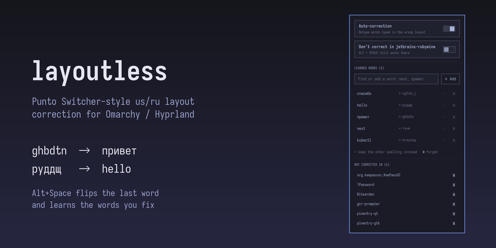

# layoutless

Automatic keyboard layout correction for [Omarchy](https://omarchy.org/) / Hyprland, in the spirit of Punto Switcher.



Type without thinking about the layout. When a word comes out in the wrong one (`ghbdtn` → `привет`, `руддщ` → `hello`), layoutless retypes it in the right layout and switches the layout for you.

> Status: 0.1, early. Works day to day on the author's machine; expect rough edges.

## Features

- **Auto-correct the last word.** When you finish a word with Space or Shift+Enter, layoutless checks whether it reads better in the other layout. If it does, it erases the word, retypes it, and leaves the corrected layout active so you can keep typing.
- **Force flip with `Alt+Space`.** If layoutless guessed wrong or missed a word, press `Alt+Space` to flip the last word. Right after an auto-correction, `Alt+Space` undoes it instead.
- **Learns your words.** If you flip the same word by hand twice, layoutless remembers which layout it belongs to. For example, `next` typed in the Russian layout comes out as `туче`, which is a valid Russian word, so a dictionary alone would never flip it. After two manual flips it always does. Undoing an auto-correction twice teaches it to leave that word alone.
- **Works everywhere you type.** It works in browsers, terminals, Electron and JetBrains apps, because it uses only Backspace and replays the same physical keys after switching the layout.
- **Omarchy bar widget.** A keyboard icon, dimmed while auto-correction is paused. Its panel pauses auto-correction, turns it off for the current app, and edits the learned words.

Supported layouts: `us` + `ru` for now. The design keeps layout pairs pluggable.

## How it works

```
physical keyboard ──evdev (read-only)──▶ layoutless daemon ──uinput──▶ Backspace × N, replay keys
                                            │  ▲
                Hyprland IPC (socket2) ─────┘  └── `layoutless flip` (Alt+Space bind)
                activelayout / activewindow       `layoutless subscribe` (bar widget)
```

1. The daemon passively reads key events from your physical keyboards and keeps the physical keys of the word being typed. It never grabs the keyboard, so typing is never delayed.
2. On a word boundary it scores the word under both layouts. It checks your learned rules first, then dictionaries, then a letter n-gram model.
3. To correct a word it sends Backspace once per key, switches the layout with `hyprctl switchxkblayout`, and replays the same physical keys. Because the keys are the same, no character mapping is needed on output.

## Privacy and permissions

layoutless has to see what you type, so its rules are strict:

- It keeps only the current and previous word, in memory only. It never logs or sends keystrokes anywhere. The exception is `LAYOUTLESS_DEBUG=1`, a debugging mode that prints every key to stderr: never leave it on.
- Learned rules (`~/.local/share/layoutless/rules.json`) store only words you flipped by hand. The file is plain JSON, so you can read and edit it.
- Reading keyboards requires membership in the `input` group, and typing requires write access to `/dev/uinput`. Any program running as your user with these permissions can read every keystroke. That's the cost of a global layout corrector on Wayland.
- Corrections are off on the lock screen, in excluded apps (password managers by default) and while the polkit password prompt is open. Words with digits, `-` or `=` are never auto-corrected, which covers most passwords. Password fields elsewhere are not detected: a letters-only password typed in the wrong layout may get corrected, so the login fails and you retype it. Nothing leaks, because nothing is logged.

## Install

layoutless has two parts: the daemon (does the work) and the Omarchy bar widget (optional UI).

### Dependencies

- Hyprland (the daemon talks to its IPC sockets). Omarchy is needed only for the bar widget.
- `libnotify` for the "word learned" notification, `util-linux` (`setpriv`) for the widget.
- Access to keyboards and `/dev/uinput`: your user in the `input` group, a udev rule and the
  `uinput` module. `install.sh` sets these up.
- To build: Rust (`omarchy pkg add rustup && rustup default stable`).

### Daemon

```bash
git clone https://github.com/kladaFOX/layoutless
cd layoutless
./install.sh
```

It builds the daemon and installs it for your user (`~/.local/bin/layoutless` and a systemd
user service). Before using `sudo` it shows what it will do and asks: a udev rule for
`/dev/uinput`, loading the `uinput` module, and adding you to the `input` group. Log out and
back in once after the first install; the daemon starts by itself afterwards. Run it again
after `git pull` to update.

An AUR package is prepared in `packaging/aur/` and will be published once AUR registration
reopens.

The daemon binds the flip key (`Alt+Space` by default, `flip_key` in the config) in Hyprland
itself and re-binds it after every Hyprland config reload; nothing is written to your Hyprland
config. Don't also bind `layoutless flip` yourself: the flip would run twice and undo itself.

### Bar widget

```bash
omarchy plugin add https://github.com/kladaFOX/layoutless --enable
```

Left click opens the panel: pause auto-correction, turn it off for the current app, and
find, add, forget or move learned words to the other layout. Right click pauses or resumes
auto-correction. The icon is dimmed while paused.

## Uninstall

```bash
omarchy plugin remove kladafox.layoutless   # the bar widget
./install.sh --uninstall                    # the daemon, service, udev rule and module config
```

Your settings (`~/.config/layoutless`) and learned words (`~/.local/share/layoutless`) are
kept; delete them by hand if you don't want them. Leave the `input` group with
`sudo gpasswd -d "$USER" input` if nothing else needs it. The flip key stays bound to a command
that only prints "daemon not running" until the next Hyprland config reload or login.

## Configuration

`~/.config/layoutless/config.toml` (optional; `layoutless reload` re-reads it):

```toml
auto = true                      # auto-correction on start
notify = true                    # desktop notification when a word is learned
learn_threshold = 2              # manual flips of the same word that make it a rule
flip_key = "ALT + SPACE"         # Hyprland syntax; the daemon binds it in Hyprland itself
exclude_apps = [                 # window classes, as in `hyprctl activewindow`
  "org.keepassxc.KeePassXC", "1Password", "Bitwarden",
  "gcr-prompter", "pinentry-qt", "pinentry-gtk",
]
exclude_layers = ["omarchy-polkit"]  # shell popups, e.g. the polkit password prompt
```

Commands: `layoutless auto on|off|toggle`, `layoutless status`, `layoutless flip`,
`layoutless rules [list | add WORD | rm WORD]`, `layoutless exclude add|rm CLASS`.

Learned words live in `~/.local/share/layoutless/rules.json`. `rules add next` makes
`next` always come out as `next` (typing `туче` turns into it); `rules add привет` does the
opposite for a Russian word.

## License

MIT for the code. The bundled word lists in `daemon/data/` are derived from
[hermitdave/FrequencyWords](https://github.com/hermitdave/FrequencyWords) (OpenSubtitles 2018)
and are licensed under [CC BY-SA 4.0](https://creativecommons.org/licenses/by-sa/4.0/);
see [daemon/data/README.md](daemon/data/README.md).
